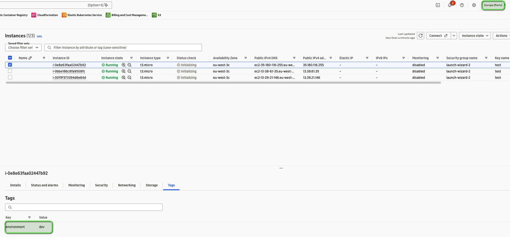
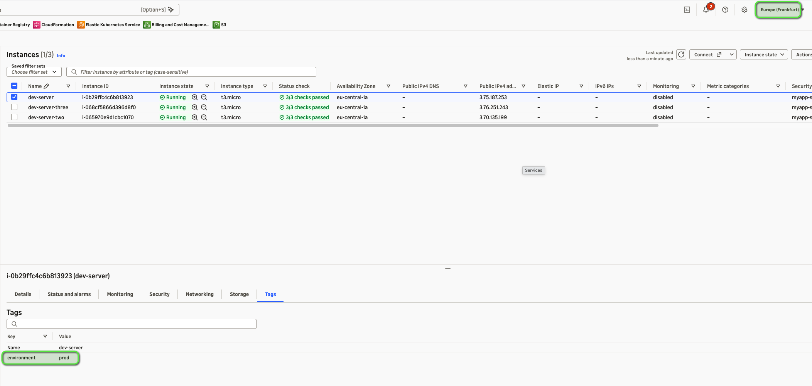
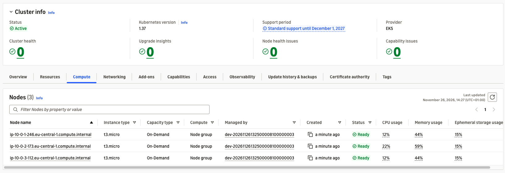

# Health Check: EC2 Status Checks

## Technologies used:

Python, Boto3, AWS, Terraform

## Project Description:

- Create EC2 Instances with Terraform
- Write a Python script that fetches statuses of EC2 Instances and prints to the console
- Extend the Python script to continuously check the status of EC2 Instances in a specific interval

## Screenshots

  
_`terraform apply` provisions the infrastructure: 10 resources added, including the three EC2 instances._

  
_The `dev-vpc` (10.0.0.0/16) created by Terraform, shown in the AWS VPC console._

  
_The three EC2 instances (`dev-server`, `dev-server-two`, `dev-server-three`) running as t3.micro in eu-central-1a._

  
_`ec2-status-checks.py` runs on a schedule and prints each instance's state, instance status and system status._

 

# Configure EC2 Server Instances: Add Environment Tags

## Technologies used:

Python, Boto3, AWS

## Project Description:

- Write a Python script that automates adding environment tags to all EC2 Server instances

## Screenshots

  
_`add-env-tags.py` tags every EC2 instance in Europe (Paris), eu-west-3, with `environment: dev`._

  
_Every EC2 instance in Europe (Frankfurt), eu-central-1, gets the tag `environment: prod`._

 

# Automate Displaying EKS Cluster Information

## Technologies used:

Python, Boto3, AWS EKS

## Project Description:

- Write a Python script that fetches and displays EKS cluster status and information

## Screenshots

  
_The `myapp-eks-cluster` is active in the AWS EKS console, running Kubernetes 1.37._

  
_The cluster's managed node group runs three t3.micro worker nodes in eu-central-1, all with status Ready._

  
_`eks-status-checks-py` uses Boto3 to fetch the cluster's status, endpoint and Kubernetes version and prints them to the console._

 
