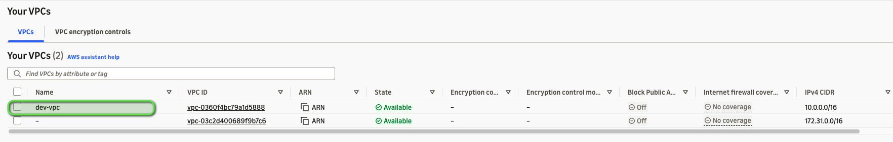
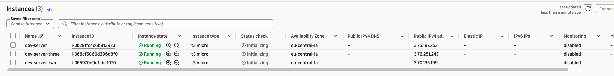

# Health Check: EC2 Status Checks

## Technologies used:

Python, Boto3, AWS, Terraform

## Project Description:

- Create EC2 Instances with Terraform
- Write a Python script that fetches statuses of EC2 Instances and prints to the console
- Extend the Python script to continuously check the status of EC2 Instances in a specific interval

## Screenshots

  
_`terraform apply` provisions the infrastructure: 10 resources added, including the three EC2 instances._

  
_The `dev-vpc` (10.0.0.0/16) created by Terraform, shown in the AWS VPC console._

  
_The three EC2 instances (`dev-server`, `dev-server-two`, `dev-server-three`) running as t3.micro in eu-central-1a._

  
_`ec2-status-checks.py` runs on a schedule and prints each instance's state, instance status and system status._
